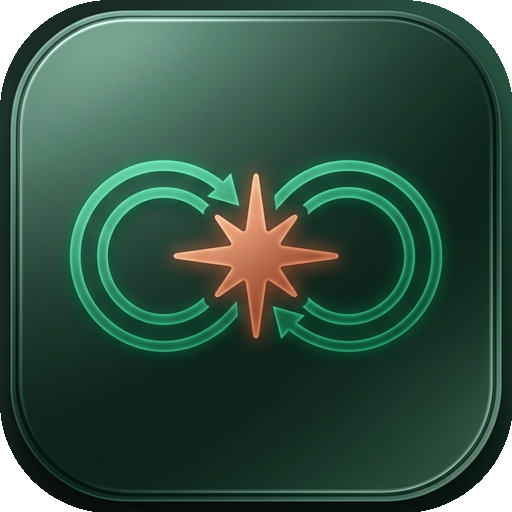
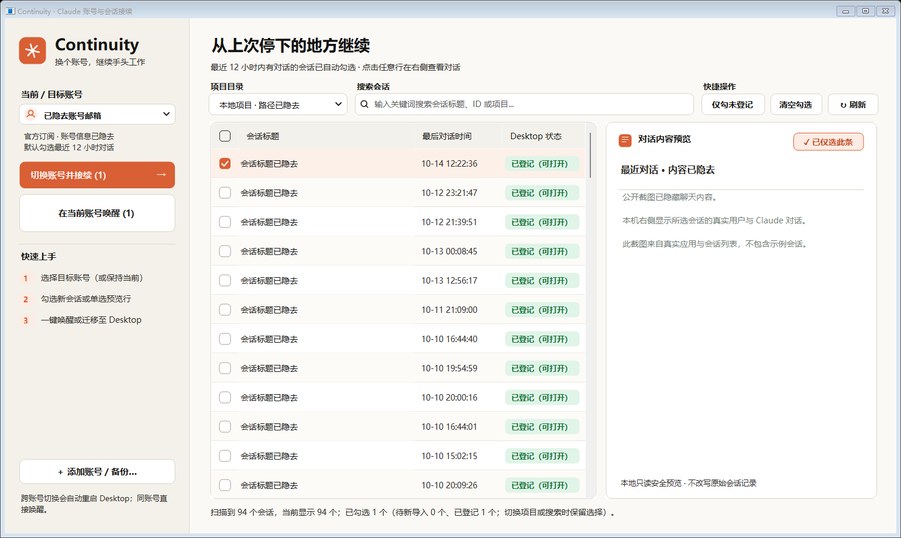
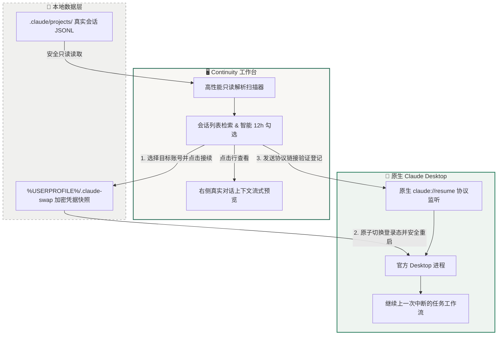

# Claude Desktop Continuity

<div align="center">



# Claude Desktop Continuity

**Windows 原生 Claude Desktop 多账号管理与本地 Code 会话无缝接续工作台**

*Switch accounts effortlessly. Resume your active Claude Code dialogues in one click.*

[](https://github.com/cosmosomo/claude-desktop-continuity)
[](https://github.com/cosmosomo/claude-desktop-continuity)
[](https://github.com/cosmosomo/claude-desktop-continuity)
[](LICENSE)
[](docs/DESIGN.md)
[](SECURITY.md)

<br/>

[✨ 核心特性](#-核心特性) • [🖼️ 界面全景](#️-界面视觉全景) • [🚀 快速开始](#-快速开始) • [📐 工作流程与原理](#-工作流程与接续原理) • [🛡️ 隐私与安全](#️-隐私与安全红线) • [🛠️ 源码构建](#️-从源码构建)

<br/>

</div>

---

> [!NOTE]
> **关于产品定位**：本工具是针对官方 Windows Claude Desktop 的独立伴侣工具（非 Anthropic 官方产品）。它在保持官方客户端原生运行的前提下，提供**本地保存账号管理**、**Code 对话记录预览**以及**跨账号一键唤醒会话**的完整生产力闭环。

---

## 🖼️ 界面视觉全景

采用**深松针（Dark Pine）导航 + 暖纸质（Warm Paper）工作区 + 翡翠绿（Accent Green）交互状态**的沉浸式原生三栏布局：


*▲ 真实程序运行截图（出于隐私保护，公开展示图已对账号邮箱、项目路径、会话标题及正文执行脱敏遮蔽）*

### 布局功能区域一览

```
┌───────────────────────────┬───────────────────────────────────────────┬───────────────────────────┐
│       左侧：账号与控制导航   │              中间：会话检索与列表选择         │      右侧：会话上下文只读预览  │
├───────────────────────────┼───────────────────────────────────────────┼───────────────────────────┤
│ • 目标账号下拉选择 (邮箱/状态)│ • 项目路径快速过滤 (支持多项目工作区)        │ • 所选会话完整标题与 ID    │
│ • 模式提示 (官方订阅/Gateway) │ • 关键字即时搜索 (标题、会话ID、目录名)      │ • 真实文字对话双向流展示    │
│ • 翡翠绿主操作：切换并接续   │ • 智能预选机制 (默认勾选最近12h活跃会话)     │ • 截断与上下文压缩状态检测  │
│ • 次级操作：在当前账号打开   │ • 状态标识 (已在 Desktop 登记 / 未登记)     │ • 最近请求 Token 消耗提示  │
│ • 底部安全工具：账号管理/备份 │ • 交互式多选 Checkbox (支持批量迁移接续)    │ • 纯本地只读解析保证安全   │
└───────────────────────────┴───────────────────────────────────────────┴───────────────────────────┘
```

---

## ✨ 核心特性

| 痛点场景 | 传统方式 | 使用 Continuity |
|---|---|---|
| **多账号切换** | 手动退出登录、重新接收验证码/扫码，费时费力 | **一键切换**：读取本地加密快照，自动重启并无感恢复登录态 |
| **会话上下文丢失** | 换账号后，旧账号正在跑的 Claude Code 会话找不到了 | **无缝接续**：通过原生 `claude://resume` 协议直接唤醒选中会话 |
| **找不准分支进度** | 仅凭盲记或在文件堆里翻找 `.jsonl` | **双向预览**：无需启动应用，右侧即时查看最近轮次真实人机对话 |
| **环境依赖繁重** | 需要安装 Python 环境、配命令行依赖 | **绿色便携**：单文件双击即用，内置 WinForms + 原生 Go 引擎 |

- 🔄 **原子级账号快照管理**：基于成熟的 Desktop Switcher 引擎，保存与切换基于 `%USERPROFILE%\.claude-swap\profiles`，数据安全隔离。
- 🎯 **智能活跃判定**：开箱即用，默认智能识别最近 12 小时内**真正发生过有效文字对话**的会话；后台单纯触碰修改的文件不会被误选。
- 🔍 **多维过滤保留选择**：切换工程项目或在搜索框输入筛选条件时，已勾选的会话集合持久保留，方便跨目录批量收集。
- ⚡ **自适应模式支持**：默认支持官方 Windows Claude Desktop；同时兼容 CC Switch 的第三方 API / Gateway 模式。

---

## 📐 工作流程与接续原理

Continuity 绝不采用“黑盒篡改 Desktop 数据库”的高风险方案，而是采用**快照恢复 + 官方原生协议唤起**的双重安全设计：



---

## 🚀 快速开始

### 方式一：直接运行便携版（推荐）

1. 前往 [Releases](https://github.com/cosmosomo/claude-desktop-continuity/releases) 下载最新的 **`claude-desktop-continuity-win64.zip`**。
2. 解压至任意固定目录（如 `D:\Tools\Continuity`）。
3. 确保你的官方 Claude Desktop 已完成首次登录并开启过一次 Code 界面。
4. 双击解压根目录下的 **`Continuity.exe`**：
   - 首次启动会自动在桌面上生成 **「Claude账号与会话」** 快捷方式。
   - 首次需要添加更多账号时，点击左下角 **「添加账号 / 备份…」**，通过托盘的 *Add account…* 登录并保存新账号。
   - 返回主窗口点击 **「刷新」**，即可在下拉框中看到所有已保存账号。
5. 勾选需要接续的会话，点击 **「切换账号并接续 →」** 即可！

> [!TIP]
> **活跃窗口时长自定义**：默认预选最近 `12` 小时内有活动的会话。若需调整，可编辑生成的 `config.local.json` 中的 `"activeSessionHours"` 字段（例如设为 `24`）。

---

## 🛡️ 隐私与安全红线

本工具在设计与代码实现中严格遵守以下安全红线：

- [x] **零解密原则**：从不尝试解密或读取 Chromium/Windows DPAPI 存储的 Cookie 与凭据明文；仅以二进制加密形态整体迁移快照。
- [x] **纯本地运行**：不包含任何外部网络上传、分析遥测（Telemetry）或中间人代理服务器。
- [x] **无损原会话**：只读扫描本地 JSONL，不重写、不修改、不合成任何会话记录文件。
- [x] **非事务明确报错**：若切换后遇网络波动或未初始化，严格弹窗提醒并中断接续，绝不破坏用户现存会话数据。

---

## 🛠️ 从源码构建

项目采用极简依赖架构，完全不需要配置 Node.js、Python 等环境，仅依赖 Go 工具链与 Windows 自带的 .NET Framework 编译器：

### 环境要求
- Windows 10 / 11 (x64)
- [Go 1.25+](https://golang.org/dl/)
- Windows 自带的 `csc.exe`（通常位于 `C:\Windows\Microsoft.NET\Framework64\v4.0.30319\csc.exe`）

### 编译步骤

在 PowerShell 中克隆并进入仓库根目录：

```powershell
# 1. 执行全量构建脚本 (编译 Go 后台引擎、托盘与 WinForms 宿主)
powershell -ExecutionPolicy Bypass -File .\scripts\continuity\Build.ps1

# 2. 生成本机独立运行配置与桌面快捷方式
powershell -ExecutionPolicy Bypass -File .\scripts\continuity\Setup.ps1

# 3. 运行本地自动化集成测试 (通过 25 项反射与业务断言)
.\dist\LocalIntegrationTests.exe "$PWD\config.local.json"
```

---

## 🤝 鸣谢与上游开源协议

- 本项目基于 [OpenScz/claude-desktop-switcher](https://github.com/OpenScz/claude-desktop-switcher) 开发，完整继承原项目的 MIT 许可证以及账号快照管理内核。
- 遵循 [MIT License](LICENSE)，欢迎提交 Issue 与改进建议。
